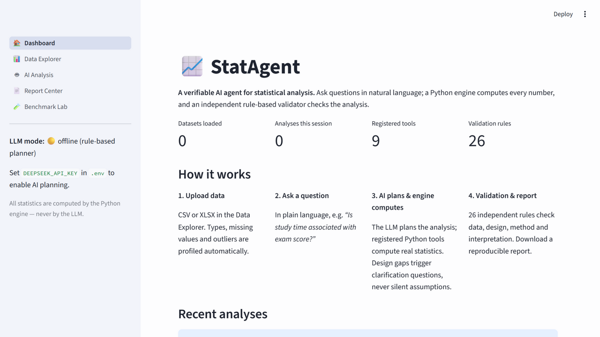
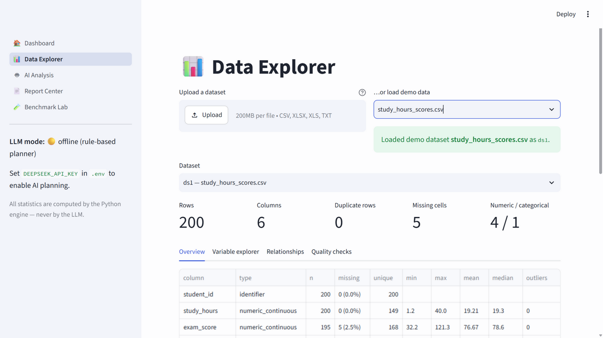
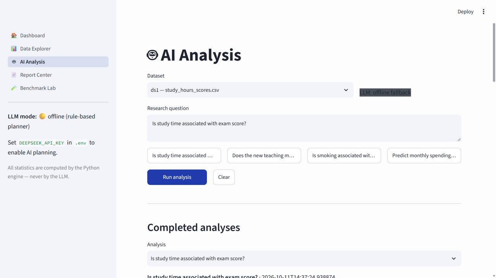
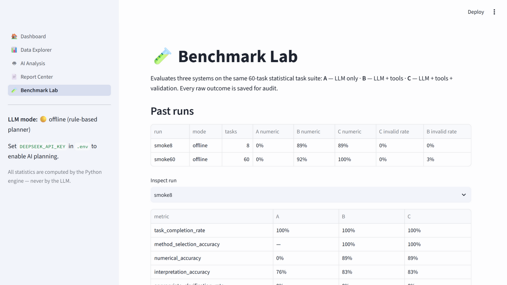

# 📈 StatAgent — A Verifiable AI Agent for Statistical Analysis

**StatAgent** combines a large language model (DeepSeek), a strict Python
statistical computation engine, and an *independent, rule-based statistical
validation engine*. You ask questions in natural language; the LLM plans the
analysis, registered Python tools compute every number, and 26 validation
rules check the data, the research design, the chosen methods and the final
interpretation — refusing analyses that are statistically unsound.

> ⚠️ **Core guarantee:** all statistical numbers come from the Python engine.
> The LLM never computes, never fabricates results, and never runs generated
> code — it only plans and paraphrases, and even its interpretation text is
> checked against the computed numbers.

---

## What it does

1. **Upload data** (CSV / XLSX) — variables are typed automatically
   (continuous, discrete, binary, ordinal, nominal, identifier…), and missing
   values, duplicates and outliers are profiled.
2. **Ask a question** — *“Is study time associated with exam score?”*,
   *“Does the new teaching method produce higher scores than the traditional
   one?”*, *“Is smoking associated with hypertension?”*.
3. **AI plans, engine computes** — the LLM produces a structured analysis
   plan (Pydantic-validated, self-repaired) that only references **registered
   statistical tools**; a strict executor validates parameters and runs the
   tested Python implementations.
4. **Design gaps trigger questions** — when critical design facts are unknown
   (independent vs paired samples, experiment vs observation, causal intent),
   the system **pauses and asks** instead of silently assuming.
5. **Independent validation gate** — 26 explicit rules across DATA / DESIGN /
   METHOD / INTERPRETATION categories return PASS / WARNING / FAIL / UNKNOWN
   with rule id, evidence and a suggested action. Blocking failures stop the
   analysis (with an explicit override option that is recorded).
6. **Interactive results & report** — charts, effect sizes, CIs, plain-language
   interpretation, and a reproducible report (Markdown + self-contained HTML)
   with dataset hash, seeds, library versions and the exact tool calls.

## Built-in statistical tools

| Family | Tools |
|---|---|
| Descriptive | `describe_variable`, `check_normality` (Shapiro-Wilk + Q-Q) |
| Correlation | `correlation_test` (Pearson/Spearman + CI), `correlation_matrix` |
| Hypothesis tests | `ttest_one_sample`, `ttest_two_sample` (Welch), `ttest_paired`, `chi_square_test` (+ Fisher for 2×2), `mann_whitney_u` |
| Regression | `linear_regression` (OLS + SEs, CIs, R²/adj-R², F, AIC/BIC, Durbin-Watson, Jarque-Bera, Breusch-Pagan, VIF, Cook's distance, residual plots) |
| Bootstrap | `bootstrap_ci` (mean/median/std/correlation, seeded, percentile CI) |

All tools handle missing values explicitly, record sample sizes, check their
inputs, produce clear errors, and are reproducible (seeded).

## Screenshots

| Dashboard | Data Explorer | AI Analysis |
|---|---|---|
|  |  |  |

| Benchmark Lab |
|---|
|  |

## Quick start

```bash
# 1. Create and activate a virtual environment (Python 3.11+)
python -m venv .venv
.venv\Scripts\activate        # Windows (Git Bash: source .venv/Scripts/activate)

# 2. Install
pip install -r requirements.txt

# 3. Optional: configure the LLM (copy .env.example to .env and fill the key)
#    Without a key the app runs in offline mode with a rule-based planner —
#    statistics are identical, only planning is heuristic.

# 4. Generate demo datasets
python scripts/generate_demo_data.py

# 5. Run the app
streamlit run app.py
```

Open http://localhost:8501. Load a demo dataset in the **Data Explorer**, then
ask a question in **AI Analysis**.

> ✅ These commands were executed and verified on Windows (Python 3.14.3).
> Linux/macOS: identical, just use `source .venv/bin/activate`.

## Configuration (environment variables)

The `.env` file in the **project root** is loaded automatically (regardless
of the directory the app is launched from; point `STATAGENT_ENV_FILE` at a
different file if needed). The `STATAGENT_`-prefixed names take precedence
over the plain aliases.

| Variable | Default | Meaning |
|---|---|---|
| `STATAGENT_DEEPSEEK_API_KEY` (or `DEEPSEEK_API_KEY`) | — | DeepSeek API key. Offline fallback when unset. |
| `STATAGENT_BASE_URL` | `https://api.deepseek.com` | OpenAI-compatible endpoint. |
| `STATAGENT_MODEL` | `deepseek-chat` | Model id (supports JSON output + function calling). |
| `STATAGENT_TEMPERATURE` | `0.0` | Sampling temperature. |
| `STATAGENT_MAX_TOKENS` | `4096` | Max completion tokens. |
| `STATAGENT_TIMEOUT` | `120` | Request timeout (seconds). |
| `STATAGENT_PRICE_INPUT` / `STATAGENT_PRICE_OUTPUT` | `0.27` / `1.10` | USD per million tokens, for cost tracking. |
| `STATAGENT_OFFLINE_FALLBACK` | `1` | Allow the rule-based planner when no key is set. |

If the API call fails while a key is configured, the app keeps working via
the offline fallback and shows a warning banner with the actual error
(e.g. 401 invalid key, rate limit, connection failure) — it never fails
silently. The key is never logged or written to reports/Git.

## Testing

```bash
.venv\Scripts\python -m pytest tests/ -q
# 152 passed in ~5s
```

The suite covers data loading (encodings, XLSX), variable typing, all
statistical tools (against known values and scipy/statsmodels references),
every validation rule (each triggered by a preset error case), the plan
schema, planner self-repair (with a mocked LLM — no API calls, no cost),
interpretation number-fidelity, report generation and benchmark scoring.

## Benchmark / research evaluation

StatAgent includes a research-grade evaluation framework studying:

> **Can rule-based statistical verification improve the reliability of
> LLM-powered data analysis?**

Three systems are compared on the same **60-task suite** (7 categories:
method selection, wrong-method traps, numerical accuracy, insufficient design,
assumption violations, causal misuse, interpretation errors):

- **System A — LLM only** (answers from the model's head, no tools)
- **System B — LLM + tools** (planner + strict execution engine)
- **System C — LLM + tools + validation** (adds the rule engine and the
  clarification loop)

```bash
python scripts/run_benchmark.py              # all 60 tasks, live LLM if key set
python scripts/run_benchmark.py --limit 20 --label pilot   # pilot subset
python scripts/run_benchmark.py --smoke      # pipeline validation, offline
```

Every run stores `results.jsonl` (raw outcomes), `ground_truth.json`,
`summary.json` (metrics with Wilson CIs, McNemar paired comparisons, costs)
and human-readable reports. See `BENCHMARK_METHODOLOGY.md` and
`RESEARCH_REPORT.md`.

**Current verified results** (offline pipeline validation run, 60 tasks —
heuristic planner, mock System A; a live-API run is pending a key):

| Metric | A (mock) | B | C |
|---|---|---|---|
| Task completion | 100% | 100% | 98% |
| Numerical accuracy | 0% | 92% | **100%** |
| Interpretation accuracy | 67% | 93% | 92% |
| Invalid analysis rate (unflagged) | 47% | 3% | **0%** |

## Repository layout

```
app.py                     Streamlit entry point
streamlit_app/             UI layer (state, components, 5 pages)
statagent/
  models/                  Pydantic schemas (plan, results, dataset)
  data/                    loading, profiling, dataset store, synthetic data
  stats/                   tool registry + statistical implementations
  validation/              rule-based validation engine (26 rules)
  agent/                   LLM clients, planner, interpreter, pipeline
  report/                  Markdown/HTML report generation
  benchmark/               task suite, systems A/B/C, metrics, runner
scripts/                   demo data + benchmark CLI
tests/                     152 tests
docs/                      screenshots + this documentation
demo_data/                 generated demo datasets
runs/                      analysis reports + benchmark artifacts
```

## Known limitations

- **Live LLM runs not yet executed** in this environment (no API key was
  available). Offline mode and the full pipeline are verified; the
  benchmark's live-results sections in `RESEARCH_REPORT.md` are marked
  pending and must not be treated as completed experiments.
- The offline planner is a heuristic fallback — it handles common phrasings
  and method names but is not a substitute for the LLM planner.
- Supported methods are the 11 registered tools; no ANOVA, survival analysis,
  mixed models, or causal inference estimators yet.
- HTML reports embed Plotly from a CDN (internet needed to view charts in
  exported HTML; the in-app UI renders charts locally).
- No multi-user support; single-process Streamlit app by design.

## License

MIT. Statistical correctness over feature count — contributions welcome.
